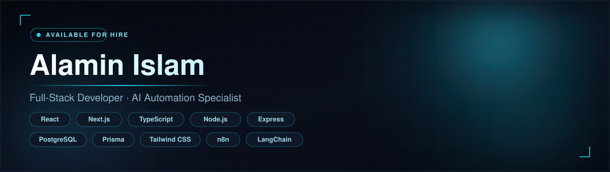
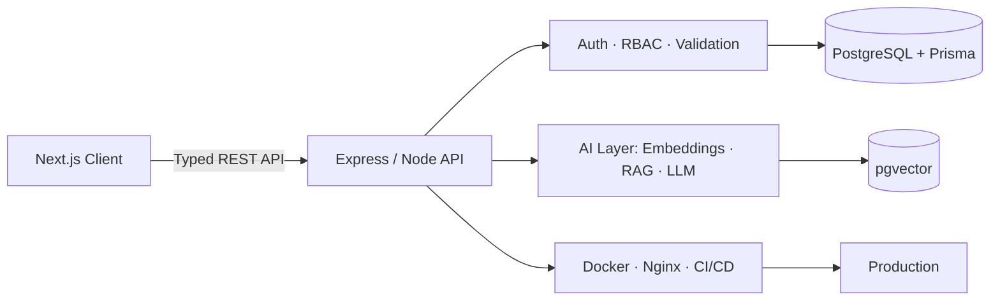

<!-- ==================== HERO ==================== -->

  

  

  
  
  
  

  
  
  

---

## ⚡ About Me

I'm a developer from **Sherpur, Bangladesh**, focused on building practical, maintainable, and user-centered software. I work across the full lifecycle: responsive interfaces, relational database schemas, APIs, third-party integrations, and deployment. I'm also growing into **AI application development**: RAG, LLM integrations, and workflow automation.

<table>
<tr>
<td width="50%" valign="top">

**💻 Development**
React · Next.js · TypeScript · Node.js · Express

**🗄️ Data**
PostgreSQL · Prisma ORM · SQL · relational modeling

**🤖 AI**
RAG · embeddings · vector search · LLM apps

</td>
<td width="50%" valign="top">

**🐳 Deployment**
Docker · Nginx · CI/CD · production operations

**🌱 Learning now**
NestJS · AI engineering · system design

**🎓 Education**
B.Sc. in Mathematics, Sherpur Government College (2020–2024)
**🌍 Languages:** Bangla (Native) · English (Conversational)

</td>
</tr>
</table>

---

## 🛠️ Technical Stack

  

| Area | Technologies |
|:--|:--|
| 🎨 **Frontend** | React.js · Next.js App Router · TypeScript · Tailwind CSS · shadcn/ui · React Hook Form · Zod |
| ⚙️ **Backend** | Node.js · Express.js · NestJS *(learning)* · REST APIs · Authentication · Authorization · Validation |
| 🗄️ **Database** | PostgreSQL · Prisma ORM · SQL · Migrations · Transactions · Query Optimization |
| 🤖 **AI & Automation** | LLM Integration · RAG Concepts · Embeddings · Semantic Search · pgvector · LangChain · n8n · Zapier · Langflow |
| 🚀 **DevOps & Tools** | Docker · Docker Compose · Nginx · Linux · Git · GitHub Actions · Postman · Vercel · Railway |
| 🔐 **Security & Quality** | Better Auth · JWT · RBAC · API Validation · Env Configuration · Error Handling · Testing *(expanding)* |

---

## 🧩 How I Build

---

## 🚀 Featured Projects

<table>
<tr>
<td width="33%" valign="top">

### 01 · GearUp

**Equipment Rental Marketplace**

Connects equipment owners with renters through listings, bookings, and payments.

- 🔐 Auth & role-based access
- 🔎 Search & availability
- 📅 Booking & rental management
- 💳 Payment integration
- 🖼️ Image uploads & reviews

`Next.js` `Express` `Prisma` `PostgreSQL` `Stripe`

</td>
<td width="33%" valign="top">

### 02 · LaunchHunt

**Product Discovery API**

A backend-focused launch platform built on REST design and relational architecture.

- 📡 RESTful product & resource endpoints
- 🗄️ PostgreSQL schema with Prisma
- 🧱 Controller / service / route layers
- 🧪 Tested & explored with Postman

`Node.js` `Express` `Prisma` `PostgreSQL`

</td>
<td width="33%" valign="top">

### 03 · AI Knowledge Assistant

**RAG Project Direction**

Retrieves information from private knowledge sources and generates context-grounded answers.

- 📄 Ingestion & chunking
- 🧠 Embeddings & semantic retrieval
- 🔍 pgvector search
- 📌 Answers with source citations
- 🔒 Retrieval evaluation & access control

`Next.js` `Node.js` `PostgreSQL` `pgvector` `LLM API` `Docker`

*Planned portfolio project. Demo and source will be added once available.*

</td>
</tr>
</table>

---

## 🏗️ Engineering Approach

| | Principle | Approach |
|:--:|:--|:--|
| 🧱 | **Architecture** | Clear module boundaries and separation of concerns |
| 🗄️ | **Data integrity** | Relational modeling, validation, transaction-aware design |
| 🔒 | **Security** | Authentication, authorization, input validation, least privilege |
| 📐 | **Type safety** | TypeScript and validated API boundaries |
| ♻️ | **Maintainability** | Reusable components, predictable structure, documentation |
| 🚢 | **Delivery** | Version control, repeatable builds, deployment discipline |
| ✅ | **Quality** | Testing, debugging, error handling, iterative improvement |

---

## 📚 Learning Roadmap

| Focus | What I'm covering | Status |
|:--|:--|:--:|
| **NestJS** | Modules, DI, guards, pipes, interceptors, testing | 🟢 Learning |
| **RAG & LLM Apps** | Embeddings, chunking, vector retrieval, evaluation, grounded generation | 🟢 Learning |
| **Docker** | Images, multi-stage builds, networking, Compose | 🟢 Learning |
| **Nginx** | Reverse proxy, domain routing, HTTPS fundamentals | 🟢 Learning |
| **CI/CD** | Linting, testing, builds, deployment workflows | 🟡 Expanding |
| **System Design** | Caching, queues, database performance, reliability | 🟡 Expanding |

---

## 📊 GitHub Analytics

  
  

  

  

---

## 🤝 Let's Connect

Open to full-stack development, backend engineering, AI-powered applications, and meaningful software projects.

  

  <i>Building useful software, learning continuously, and growing through real-world engineering.</i>

